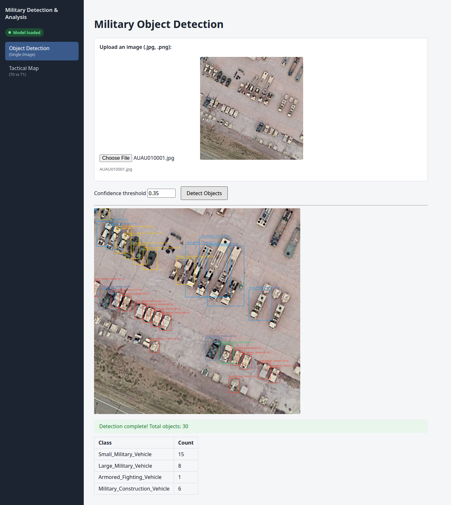
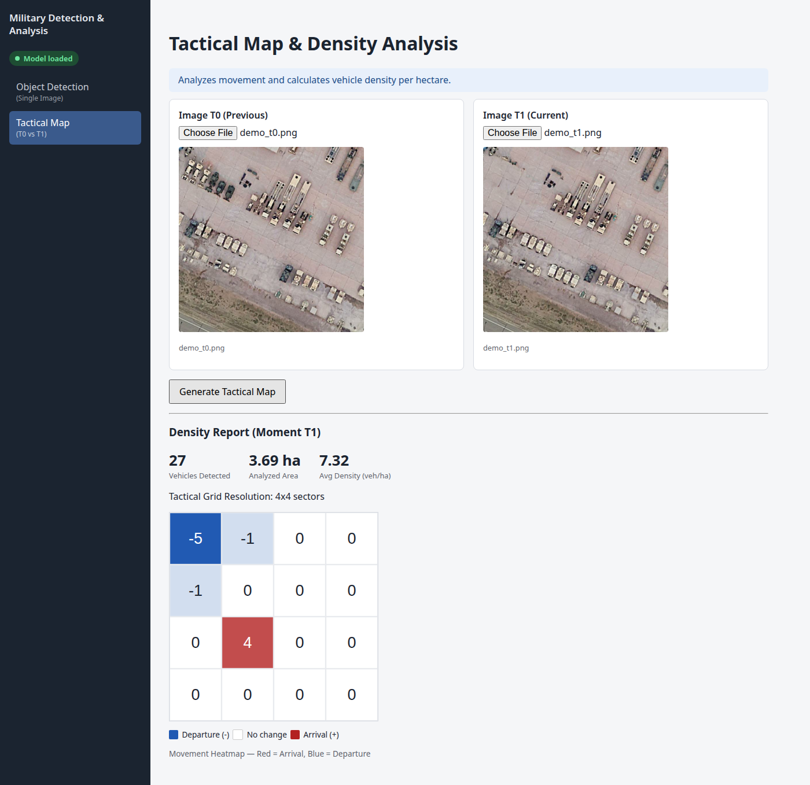
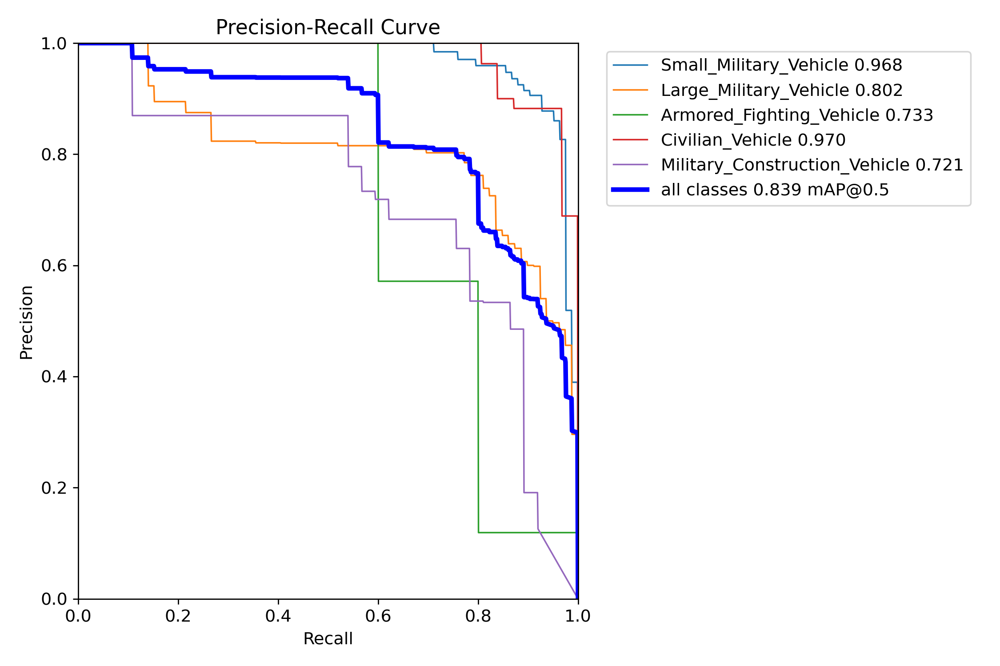
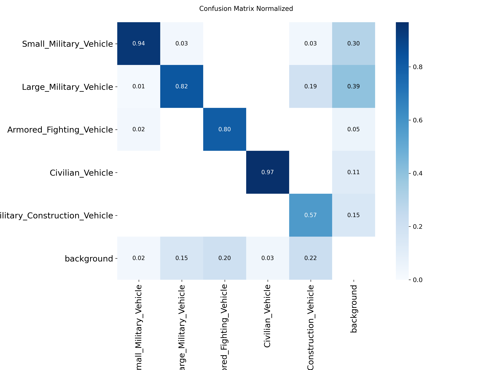

# Military Vehicle Detection & Change Analysis

[](https://github.com/shers0a/military-vehicle-detection-app/actions/workflows/ci.yml)

Detects and classifies military vehicles in high-resolution satellite imagery, and maps
where vehicles **arrived or left** between two acquisitions of the same area.

- **Model:** YOLOv8m fine-tuned on 5 vehicle classes, run with SAHI sliced inference so that
  small objects in large tiles are not missed.
- **Architecture:** a Python **FastAPI** inference microservice behind a **.NET 10 Blazor
  Server** front end, talking over HTTP. Both are containerized and start with one command.
- **Quality:** unit and API tests in both stacks, and GitHub Actions CI that also builds
  the container images.

Started at the ROSPIN Satellite Data Processing Masterclass 2025 as a single Streamlit
script, then rebuilt as a two-service application.



## Features

**Object detection.** Upload an image and get bounding boxes, a per-class count and a
confidence threshold you can tune per request. The five classes are:

| Class | Example |
|---|---|
| `Small_Military_Vehicle` | light utility vehicles, jeeps |
| `Large_Military_Vehicle` | trucks, transporters, launchers |
| `Armored_Fighting_Vehicle` | tanks, IFVs, APCs |
| `Military_Construction_Vehicle` | engineering and construction equipment |
| `Civilian_Vehicle` | cars and civilian trucks |

**Tactical map (change detection).** Upload two images of the same area (T0 and T1). Every
military vehicle is reduced to its center point and binned into a grid of 50 m × 50 m ground
sectors. The map shows `count(T1) − count(T0)` per sector: **red** where vehicles arrived,
**blue** where they left. It also reports vehicle density per hectare at T1. Civilian
vehicles are excluded so that ordinary traffic doesn't drown out military movement.



> **About this demo pair.** The dataset has no multi-temporal pairs, so **T1 above is a
> synthetically edited copy of T0**: six construction vehicles were removed and a row of
> four small vehicles was cloned onto empty tarmac. It demonstrates the change view only.
> It is generated by [`tools/make_synthetic_pair.py`](tools/make_synthetic_pair.py).

The sidebar badge shows whether the inference service is reachable and has a model loaded.
If either is missing, the app degrades gracefully instead of crashing.

## Model

Training used YOLOv8m (COCO-pretrained) for 100 max epochs with early stopping (patience 20),
`imgsz=1280`, batch 4, and rotation (±45°), vertical flip and mosaic augmentation. Training
stopped after 70 epochs, about 8 hours on a single GPU. The best checkpoint is from epoch 50.

| Metric (validation) | Value |
|---|---|
| Precision | 0.794 |
| Recall | 0.760 |
| mAP@0.5 | **0.839** |
| mAP@0.5:0.95 | 0.592 |

Per-class mAP@0.5: small military 0.968 · civilian 0.970 · large military 0.802 ·
armored 0.733 · construction 0.721.

> **Caveat:** the validation split is small: 18 tiles with 235 objects, of which only 5 are
> armored vehicles. Treat these numbers as indicative, not as a robust benchmark. A larger
> held-out test split is the first thing to add.

<p>
  
  
</p>

**Dataset:** [MVRSD](https://github.com/baidongls/MVRSD) (Military Vehicle Remote Sensing
Dataset). It contains 640 × 640 tiles at 0.3 m/px from Google Earth imagery, taken from more
than 40 military scenes. This training run used 2,382 tiles for training and 18 for
validation. The dataset and the trained weights are **not** included in this repository.

## Architecture


**Key design decisions**

- **Two services, one HTTP contract.** The ML ecosystem (Ultralytics, SAHI, PyTorch) lives in
  Python, and the UI and orchestration live in .NET. `MilitaryTrack.Core` has no Blazor
  dependency, so a future CLI or worker can reuse the same typed client.
- **Sliced inference.** Vehicles are a few dozen pixels wide. SAHI cuts the image into
  overlapping 640 px tiles, runs YOLO on each one and merges the boxes.
- **Load once, filter per request.** SAHI fixes the confidence threshold when the model is
  constructed. The model therefore loads once at startup with a low floor (0.05), and the
  user's threshold is applied after inference, so it can change per request without
  reloading 50 MB of weights.
- **Concurrency.** Inference is blocking CPU/GPU work, so the endpoints are plain `def`.
  FastAPI runs them in its thread pool, and `/health` stays responsive during a long
  detection. A regression test guards this. Ultralytics models are not thread-safe, so a
  single lock serializes access to the shared model.
- **Weights as a volume, not in the image.** The image contains code only, so a new model
  needs no rebuild and weights never end up in a registry.
- **Validation at the edge.** Out-of-range parameters are rejected with 422, and non-image
  uploads with 400. The .NET client turns FastAPI's validation errors into readable messages
  for the UI.
- **Rendering in the browser.** Boxes and heatmaps are drawn as SVG by Blazor components.
  The API returns only JSON, with no server-side plotting.

## Quick start (containers)

You need Podman or Docker, plus the trained weights.

```bash
cp /path/to/best.pt models/best.pt
podman compose up --build        # or: docker compose up --build
```

- UI: <http://localhost:5095>
- Inference API (Swagger UI): <http://localhost:8000/docs>

Without `models/best.pt` everything still starts, and the UI shows **Model not loaded**.

## Local development

Use [uv](https://docs.astral.sh/uv/) to install the dependencies, as the Dockerfile and CI
do. pip's resolver can backtrack for a very long time over opencv/numpy versions here.

```bash
# Inference service (Python 3.11 - required by the numpy<2 / torch / SAHI combination)
cd inference_service
uv venv --python 3.11 .venv && source .venv/bin/activate
uv pip install torch torchvision --index-url https://download.pytorch.org/whl/cpu  # CPU-only build
uv pip install -r requirements-dev.txt
uvicorn app.main:app --reload --port 8000

# Web app (.NET 10 SDK), in another terminal, from the repo root
dotnet run --project src/MilitaryTrack.Web
```

The service looks for weights in `models/best.pt`, or wherever `MODEL_PATH` points (see
`inference_service/.env.example`). It uses CUDA automatically when available.

## API

| Method | Endpoint | Purpose |
|---|---|---|
| `GET` | `/api/v1/health` | Liveness and model status (`ok` / `degraded`) |
| `GET` | `/api/v1/config` | Class list and default parameters |
| `POST` | `/api/v1/detect` | `file` + optional `confidence_threshold` [0–1], `slice_size` [64–4096], `overlap_ratio` [0–0.9] |
| `POST` | `/api/v1/tactical-map` | `file_t0`, `file_t1` + optional `confidence_threshold`, `gsd_m_per_px`, `grid_size_m` |

## Tests & CI

```bash
cd inference_service && python -m pytest     # 24 tests
dotnet test MilitaryTrack.slnx               # 5 tests (from the repo root)
```

- **Python:** grid and density math, request validation, endpoint behaviour with a fake model
  (no weights needed), and a regression test proving `/health` answers during a long inference.
- **.NET:** `InferenceClient` JSON mapping, culture-invariant form fields and error handling,
  using a stub `HttpMessageHandler`.
- **CI** ([`.github/workflows/ci.yml`](.github/workflows/ci.yml)): .NET build and tests,
  Python tests, and builds of both container images, on every push.

## Repository layout

```
inference_service/       FastAPI service: app/ (routers, detection, tactical math), tests/, Dockerfile
src/MilitaryTrack.Core/  .NET class library: InferenceClient + DTOs
src/MilitaryTrack.Web/   Blazor Server UI, Dockerfile
tests/                   .NET tests (xUnit)
tools/                   Helper scripts (synthetic demo pair)
models/                  Put best.pt here (git-ignored)
compose.yaml             Whole stack, one command
antrenare.py, config.yaml  YOLOv8 training script and dataset config
legacy/streamlit_app/    Original Streamlit prototype, kept for reference
```

## Limitations & roadmap

- **Small validation split.** See the caveat above.
- **Pixel grid, not geographic coordinates.** The tactical map assumes T0 and T1 are
  co-registered and share the same resolution. Georeferenced input (GeoTIFF) and a map view
  are natural next steps.
- **Synchronous CPU inference** is fine for single tiles. Large mosaics would need a GPU,
  batching and a background job queue.
- **Wide-area monitoring (Phase 2).** The idea is to watch large areas with free Sentinel-2
  imagery as an early-warning layer, then confirm flagged areas with high-resolution imagery.
  At 10 m/px individual vehicles are not visible, so this needs a separate change-detection
  model, PostGIS storage and scheduled jobs. It is **not implemented yet**.

## Credits

- ROSPIN Satellite Data Processing Masterclass 2025, where the project started.
- Dataset: MVRSD, *Journal of Image and Graphics*, DOI
  [10.11834/jig.230884](https://doi.org/10.11834/jig.230884). Imagery © Google Earth.
- [Ultralytics YOLOv8](https://github.com/ultralytics/ultralytics) and [SAHI](https://github.com/obss/sahi).
